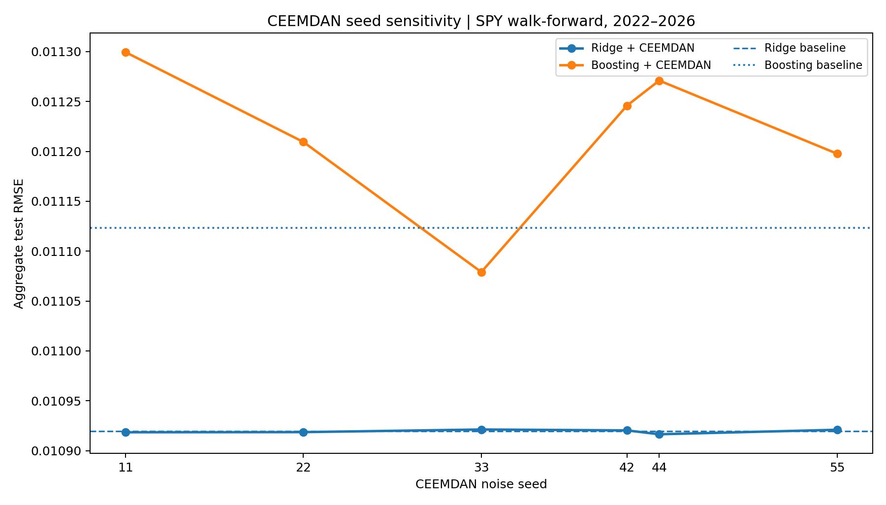
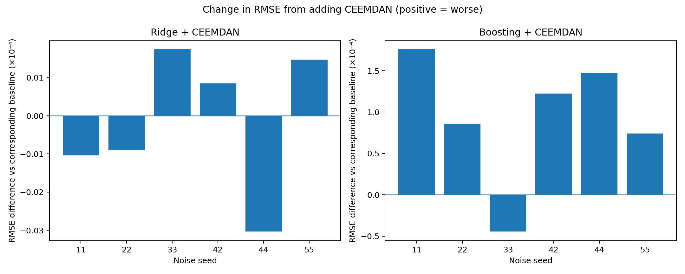

# Leakage-Conscious Multiscale Financial Forecasting

**A reproducible applied mathematics / machine learning research prototype** investigating whether rolling empirical-mode-decomposition features help forecast next-day SPY ETF log returns beyond simple statistical and ML baselines.


**Status (October 2026):** Completed a fixed-window benchmark and five-fold annual expanding-window walk-forward evaluation of seven SPY next-day return forecasting configurations, including rolling EMD and CEEMDAN features. Audited dataset fingerprints and aligned targets, ran paired HAC loss comparisons with multiple-testing correction, and assessed CEEMDAN seed sensitivity across six seeds with an exact same-seed repeatability check. **18 automated tests pass** in the verified local environment. This is an independent research prototype—not an exact reproduction of the cited paper, a verified trading strategy, or evidence of profitability.

## Frozen-data results (SPY, October 2026)

We evaluated Ridge regression, gradient boosting, and trailing-window EMD/CEEMDAN variants on the **same frozen SPY adjusted-price series**: 4,219 closing prices and 1,197 matching test predictions.

The historical-mean benchmark achieved the lowest test RMSE (**0.010868**). No decomposition variant convincingly outperformed it.

These results represent a preliminary fixed-window forecasting evaluation, **not evidence of trading profitability**.

### Model performance comparison


### Actual vs. predicted returns


### Cumulative forecasting error


See [full metrics, dataset audit, interpretation, and limitations](docs/RESULTS.md).

## Walk-forward evaluation (2022–October 2026)

We evaluated **seven models** on the same frozen SPY adjusted-price series using expanding-window retraining across five annual test folds. The three runs have matching dataset fingerprints, test targets, and baseline predictions (1,197 aligned out-of-sample dates). **Historical mean achieved the lowest aggregate RMSE (0.010869)**; EMD and CEEMDAN did not improve aggregate RMSE relative to their corresponding ML baselines. These are forecasting results, not trading-performance or statistical-significance claims.


[Read the full walk-forward results and dataset audit](docs/WALK_FORWARD_RESULTS.md).

## Statistical significance and robustness

Paired squared-error comparisons on **1,197 walk-forward predictions** used HAC standard errors with lags 0, 5, 10, and 20 and Holm correction. **None of the six models showed a statistically significant difference from the historical-mean benchmark at the 5% level after correction across the examined bandwidths.** Four direct EMD/CEEMDAN-versus-base-learner comparisons (HAC lag 5) were also nonsignificant after Holm correction. These findings **do not establish model equivalence**.

See [statistical analysis, corrected p-values, and limitations](docs/STATISTICAL_RESULTS.md).

## CEEMDAN random-seed stability (October 2026)

Using one frozen SPY dataset and identical annual walk-forward folds, we repeated CEEMDAN-augmented Ridge and gradient-boosting experiments with six noise seeds (11, 22, 33, 42, 44, 55). A second seed-11 run reproduced **all 1,197 predictions exactly** in the tested environment. Across seeds, Ridge forecasts were comparatively stable, while gradient-boosting forecasts showed greater seed-dependent variability. No seed beat the historical-mean RMSE. These are exploratory findings, not a statistical stability guarantee.





See [the six-seed results, exact metrics, audit, and limitations](docs/SEED_STABILITY.md).

## Research question

Do features from **trailing-window EMD or CEEMDAN**, computed at each date using *only prices observable on that date*, improve next-day return forecasts over conventional lag, momentum, and realized-volatility features?

Inspired by: Tim Leung and Theodore Zhao (2021), *Financial time series analysis and forecasting with Hilbert–Huang transform feature generation and machine learning*, *Applied Stochastic Models in Business and Industry* 37(6), 993–1016. [DOI](https://doi.org/10.1002/asmb.2625) · [arXiv](https://arxiv.org/abs/2105.10871).

This repository is an **independent methodological prototype**, not an exact implementation of the paper's CEEMD/HHT feature framework. In particular, CEEMDAN is a different algorithm from CEEMD, and the current features summarize terminal IMF amplitudes rather than computing the full Hilbert spectrum or instantaneous frequencies.

## Quick start

Python 3.10+:

```bash
python -m venv .venv
source .venv/bin/activate     # Windows: .venv\\Scripts\\activate
pip install -r requirements.txt
python -m pytest -q
python -m src.experiment --output results/spy_baselines
```

The last command downloads daily adjusted SPY closing prices using `yfinance` (connection needed), then produces:

- `results/spy_baselines/metrics.csv`
- `results/spy_baselines/predictions.csv`
- `results/spy_baselines/test_predictions.png`
- `results/spy_baselines/run_metadata.json`

**Note:** Yahoo Finance data can undergo revisions, may have missing entries or rate limits, and must be validated before research publication.

### Optional decomposition experiments

```bash
# Faster deterministic rolling EMD (can take several minutes):
python -m src.experiment --emd emd --output results/spy_emd

# Slower, stochastic noise-assisted CEEMDAN (can take much longer):
python -m src.experiment --emd ceemdan --ceemdan-trials 12 --output results/spy_ceemdan
```

EMD/CEEMDAN runs the decomposition **independently on the trailing 80 trading closes for each feature date**. Never run decomposition on the complete history and split later: that creates information leakage. Even rolling decomposition has end-point instability and computational expense.

### Offline data option

Prepare a CSV with **`Date,Close`** using adjusted closing prices (not unadjusted close). Then run:

```bash
python -m src.experiment --csv data/spy_adjusted.csv --output results/spy_csv
```

The CSV should contain observations from 2010 through the test period. The repository intentionally excludes downloaded third-party price data.

## Experiment design

- **Target:** next-observation SPY adjusted-close log return, `log(Close[t+1]/Close[t])`.
- **Frozen input:** 4,219 adjusted daily SPY closes from January 4, 2010 through October 12, 2026; the downloaded provider data remain local rather than committed to GitHub.
- **Feature construction:** lagged returns, rolling statistics, volatility, momentum, and (optionally) four exploratory terminal-IMF summaries from trailing 80-close EMD or CEEMDAN decompositions. Features at date `t` use prices no later than `t`.
- **Forecasting models:** historical-mean return, standardized Ridge, histogram gradient boosting, and the Ridge/boosting variants augmented with EMD or CEEMDAN features (seven configurations total).
- **Original fixed-window study:** training through 2018, an additional 2019–2021 period included in the final fit, and test dates from 2022 onward. The 2019–2021 period was **not** an independent holdout for the reported final fit. See [fixed-window results](docs/RESULTS.md).
- **Walk-forward study:** expanding training history with a refit at the beginning of each test calendar year (2022, 2023, 2024, 2025, and partial 2026). For each fold, training labels are observed before the first test feature date; 1,197 test observations align across models. See [walk-forward methods and results](docs/WALK_FORWARD_RESULTS.md).
- **Evaluation:** RMSE, MAE, and directional accuracy; paired squared-error loss comparisons use HAC/Newey–West standard errors and Holm correction. See [statistical results](docs/STATISTICAL_RESULTS.md).
- **Randomness audit:** CEEMDAN seeds `11, 22, 33, 42, 44, 55`, with a repeat run of seed 11. Baseline predictions, dates, targets, and frozen input match; seed 11's 1,197 forecasts repeated exactly in the tested environment. The original seed-42 run used the previous implicit default. See [seed-stability audit](docs/SEED_STABILITY.md).
- **Parameter selection:** fixed illustrative model settings; no independently tuned nested validation, trading-cost analysis, or economic profitability claims.

### Reproduce the walk-forward workflow

Prepare a **local** adjusted-price CSV with columns `Date,Close` (the data snapshot is not included in the repository), then run:

```bash
python -m pip install -r requirements.txt
python -m pytest -q
python -m src.walk_forward --csv data/spy_adjusted_frozen.csv --output results/walk_forward_baseline
python -m src.walk_forward --csv data/spy_adjusted_frozen.csv --emd emd --output results/walk_forward_emd
python -m src.walk_forward --csv data/spy_adjusted_frozen.csv --emd ceemdan --seed 11 --output results/walk_forward_ceemdan_seed11
```

CEEMDAN is considerably slower than the other runs. The local CSV should use the same adjusted-price snapshot for meaningful comparisons; fetching today's live prices will not necessarily reproduce the October 2026 results. The analysis outputs include metrics, predictions, and metadata, including the dataset fingerprint.

### Limitations and future work

**Completed evaluations:** The project includes a controlled fixed-window benchmark, five annual expanding-window walk-forward test folds (2022–2026), paired squared-error comparisons with HAC standard errors, Holm multiple-testing correction, and a six-seed CEEMDAN sensitivity analysis. A repeated seed-11 experiment reproduced the saved predictions exactly.

**Remaining research limitations:**

1. Hyperparameters have not undergone independent nested walk-forward tuning.
2. The experiment uses one asset (SPY) and one historical period; results may not generalize to other assets or regimes.
3. Terminal IMF amplitudes are exploratory features. IMF count, frequency interpretation, and mode mixing may vary between rolling windows.
4. Statistical tests use approximate HAC inference; alternative dependence assumptions and nested-model forecast tests merit further study.
5. Six CEEMDAN seeds provide descriptive stability evidence, not a complete characterization of stochastic variability.
6. Directional accuracy is not trading profitability. Transaction costs, market impact, risk, and portfolio performance were not evaluated.
7. Future work includes more robust multiscale representations, additional assets, independent model tuning, and broader out-of-sample validation.

## Repository layout

```text
src/
  experiment.py                  Fixed-window forecasting pipeline
  walk_forward.py                Annual expanding-window evaluation
  significance.py                HAC comparisons against historical mean
  decomposition_significance.py  Direct decomposition-versus-baseline tests

tests/
  test_experiment.py             Forecasting pipeline tests
  test_walk_forward.py           Walk-forward, alignment, and seed-control tests
  test_statistical_analysis.py   Statistical-analysis tests

docs/
  RESULTS.md                     Frozen-data benchmark
  WALK_FORWARD_RESULTS.md        Walk-forward evaluation
  STATISTICAL_RESULTS.md         Paired forecast-loss analysis
  SEED_STABILITY.md              Six-seed CEEMDAN sensitivity audit
  significance/                  HAC robustness tables

figures/                          Benchmark and research visualizations
.github/workflows/tests.yml       Automated testing
requirements.txt                  Python dependencies
README.md                         Project overview
```

The repository includes 18 passing automated tests in the verified local environment. Downloaded third-party SPY price data is not committed.

## Resume-safe summary

> Developed an independent Python quantitative research pipeline evaluating next-day SPY return forecasts using Ridge regression, gradient boosting, and rolling EMD/CEEMDAN features. Implemented leakage-conscious feature construction, five annual expanding-window walk-forward folds (1,197 out-of-sample predictions per model), HAC forecast-loss comparisons with Holm correction, and a six-seed CEEMDAN stability analysis. Validated the pipeline with 18 automated tests.

The historical-mean benchmark achieved the lowest aggregate walk-forward RMSE (approximately 0.010869). The decomposition features did not demonstrate a consistent forecasting advantage. No trading-profitability claims are made.

## Reproducibility

Use a compatible Python environment and install dependencies from `requirements.txt`; its version ranges are not a fully pinned lockfile. For exact numerical reproduction, use the **same frozen adjusted-close CSV**, settings, and compatible dependency versions. The saved `run_metadata.json` fingerprints, test dates, and predictions support cross-run auditing; the October 2026 dataset is not distributed in the repository.

The project evolved from an earlier fixed-window baseline to aligned frozen-data experiments, then to annual expanding-window evaluation, statistical comparisons, and seed-stability checks. The earlier fixed-window runs and the more rigorous walk-forward results are documented separately above. Avoid combining metrics from differently downloaded price datasets or describing the approximate significance tests as proof of model equivalence.
