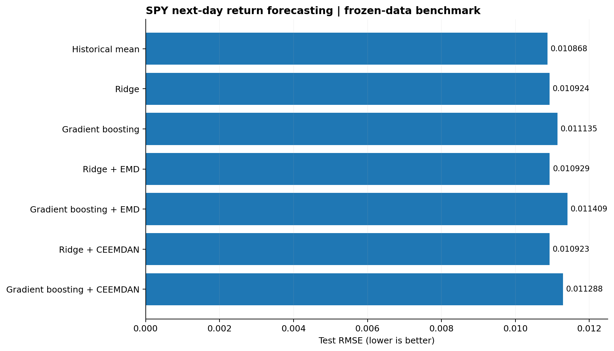
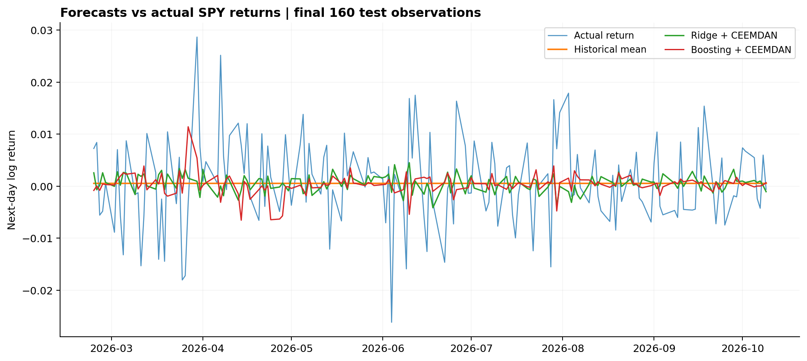
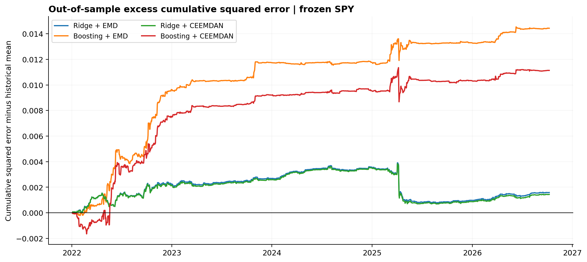
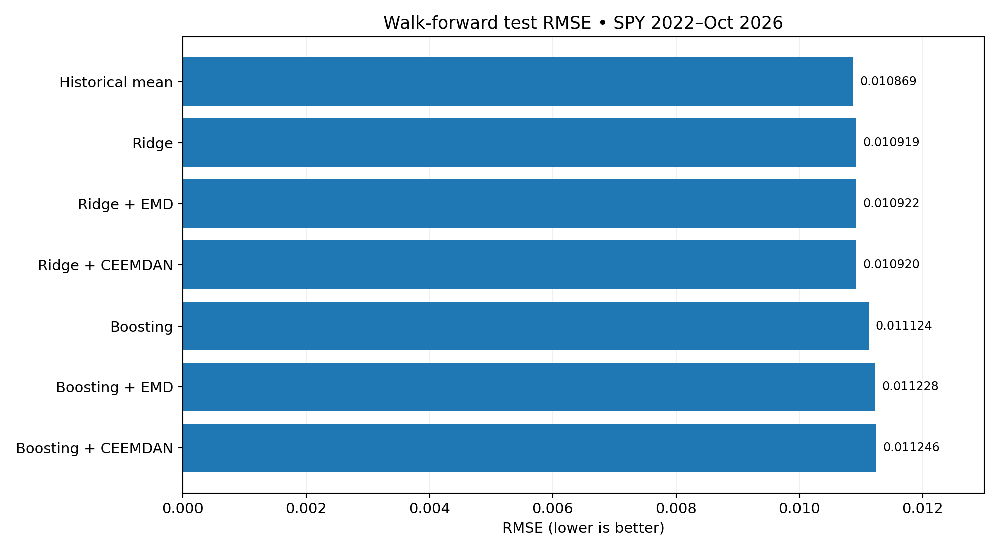
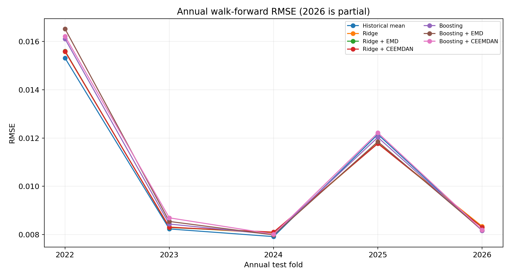
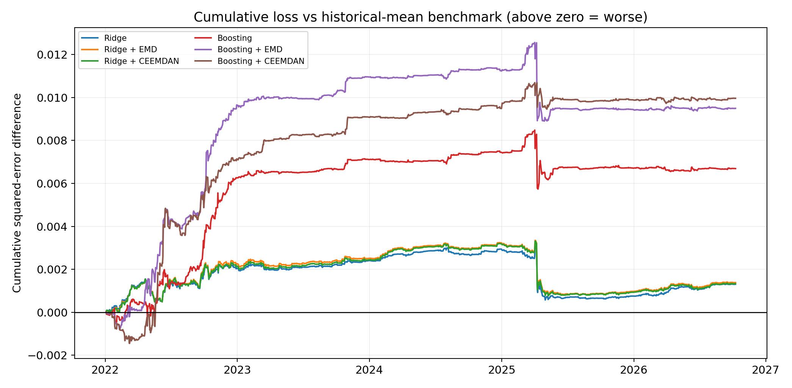

# Leakage-Conscious Multiscale Financial Forecasting

**A reproducible applied mathematics / machine learning research prototype** investigating whether rolling empirical-mode-decomposition features help forecast next-day SPY ETF log returns beyond simple statistical and ML baselines.


**Status:** Implemented and tested a Python forecasting pipeline with historical-mean, Ridge, gradient-boosting, EMD, and CEEMDAN models. Completed a controlled experiment using one frozen SPY dataset, with matching dataset fingerprints and test targets across three runs. See [verified experimental results](docs/RESULTS.md). This remains a preliminary research prototype, not a validated investment strategy or an exact reproduction of the cited study.

## Frozen-data results (SPY, October 2026)

We evaluated Ridge regression, gradient boosting, and trailing-window EMD/CEEMDAN variants on the **same frozen SPY adjusted-price series**: 4,219 closing prices and 1,197 matching test predictions.

The historical-mean benchmark achieved the lowest test RMSE (**0.010868**). No decomposition variant convincingly outperformed it.

These results represent a preliminary fixed-window forecasting evaluation, **not evidence of trading profitability**.

### Model performance comparison



### Actual vs. predicted returns



### Cumulative forecasting error



See [full metrics, dataset audit, interpretation, and limitations](docs/RESULTS.md).

## Walk-forward evaluation (2022–October 2026)

We evaluated **seven models** on the same frozen SPY adjusted-price series using expanding-window retraining across five annual test folds. The three runs have matching dataset fingerprints, test targets, and baseline predictions (1,197 aligned out-of-sample dates). **Historical mean achieved the lowest aggregate RMSE (0.010869)**; EMD and CEEMDAN did not improve aggregate RMSE relative to their corresponding ML baselines. These are forecasting results, not trading-performance or statistical-significance claims.







[Read the full walk-forward results and dataset audit](docs/WALK_FORWARD_RESULTS.md).

## Statistical significance and robustness

Paired squared-error comparisons on **1,197 walk-forward predictions** used HAC standard errors with lags 0, 5, 10, and 20 and Holm correction. **None of the six models showed a statistically significant difference from the historical-mean benchmark at the 5% level after correction across the examined bandwidths.** Four direct EMD/CEEMDAN-versus-base-learner comparisons (HAC lag 5) were also nonsignificant after Holm correction. These findings **do not establish model equivalence**.

See [statistical analysis, corrected p-values, and limitations](docs/STATISTICAL_RESULTS.md).

## Research question

Do features from **trailing-window EMD or CEEMDAN**, computed at each date using *only prices observable on that date*, improve next-day return forecasts over conventional lag, momentum, and realized-volatility features?

Inspired by: Tim Leung and Theodore Zhao (2021), *Financial time series analysis and forecasting with Hilbert–Huang transform feature generation and machine learning*, *Applied Stochastic Models in Business and Industry* 37(6), 993–1016. [DOI](https://doi.org/10.1002/asmb.2625) · [arXiv](https://arxiv.org/abs/2105.10871).

This repository is an **independent methodological prototype**, not an exact implementation of the paper's CEEMD/HHT feature framework. In particular, CEEMDAN is a different algorithm from CEEMD, and the current features summarize terminal IMF amplitudes rather than computing the full Hilbert spectrum or instantaneous frequencies.

## Quick start

Python 3.10+:

```bash
python -m venv .venv
source .venv/bin/activate     # Windows: .venv\\Scripts\\activate
pip install -r requirements.txt
python -m pytest -q
python -m src.experiment --output results/spy_baselines
```

The last command downloads daily adjusted SPY closing prices using `yfinance` (connection needed), then produces:

- `results/spy_baselines/metrics.csv`
- `results/spy_baselines/predictions.csv`
- `results/spy_baselines/test_predictions.png`
- `results/spy_baselines/run_metadata.json`

**Note:** Yahoo Finance data can undergo revisions, may have missing entries or rate limits, and must be validated before research publication.

### Optional decomposition experiments

```bash
# Faster deterministic rolling EMD (can take several minutes):
python -m src.experiment --emd emd --output results/spy_emd

# Slower, stochastic noise-assisted CEEMDAN (can take much longer):
python -m src.experiment --emd ceemdan --ceemdan-trials 12 --output results/spy_ceemdan
```

EMD/CEEMDAN runs the decomposition **independently on the trailing 80 trading closes for each feature date**. Never run decomposition on the complete history and split later: that creates information leakage. Even rolling decomposition has end-point instability and computational expense.

### Offline data option

Prepare a CSV with **`Date,Close`** using adjusted closing prices (not unadjusted close). Then run:

```bash
python -m src.experiment --csv data/spy_adjusted.csv --output results/spy_csv
```

The CSV should contain observations from 2010 through the test period. The repository intentionally excludes downloaded third-party price data.

## Experiment design

- **Target:** next-day log return `log(Close[t+1]/Close[t])`.
- **Data:** SPY adjusted daily closing prices; 2010 onward by default.
- **Training:** through 2018-12-31.
- **Validation:** 2019-01-01 through 2021-12-31.
- **Test:** 2022-01-01 onward (through date of data download).
- **Controls:** lagged daily returns, rolling means, rolling volatility, five-day momentum.
- **Models:** historical-mean return, standardized Ridge regression, histogram gradient boosting.
- **Decomposition models:** same two ML models with additional *past-only* rolling-EMD features; aligned sampling for fair comparisons. All modes, including `none`, discard the same initial warmup interval to align baseline training samples.
- **Metrics:** test RMSE, MAE, and sign accuracy. No claim of trading performance.
- **Hyperparameters:** fixed illustrative values; not optimized on test. The current code combines the training and validation periods for its final fit; therefore validation is **not** an independent evaluation holdout. Hyperparameters are fixed for demonstration purposes.

### Important limitations / roadmap

1. The first run uses a **single fixed test window**; a credible scientific comparison needs multi-fold purged/embargoed or walk-forward evaluation (and parameter tuning entirely within each training period).
2. EMD/CEEMDAN decompositions have **mode-mixing and inconsistent IMF count/order** across rolling windows. Terminal coefficients here are *exploratory*, not stable physically defined frequency bands.
3. The current experiment does not implement the paper's full HHT instantaneous amplitude/frequency features, SVM, or LSTM. Its results **must not** be represented as a replication of published results.
4. Direction accuracy is not a portfolio-return measure. Transaction costs, trading constraints, risk, and significance testing are out of scope.
5. Data adjustments, source limitations, and decisions about price-vs-return decomposition affect interpretation and need explicit sensitivity checks.
6. A higher score on a single evaluation period does not establish robust predictive ability.

## Repository layout

```text
src/experiment.py           download, features, evaluation and plots
tests/test_experiment.py    seven automated tests including forward-data invariance and fair baseline matching
.github/workflows/tests.yml GitHub Actions automated testing
requirements.txt
README.md
```

## Resume-safe summary

> Built a Python research pipeline to evaluate next-day SPY return forecasting using time-series baselines and trailing-window empirical-mode decomposition; implemented chronological data splitting, leakage checks, automated tests, and RMSE/MAE/directional-accuracy reporting.

Use a completed past-tense claim only for activities you have actually performed. Add real market performance numbers **only after running and verifying a downloaded-SPY experiment**.

## Reproducibility

Suggested environment: Python 3.11. Install dependencies from `requirements.txt`; the ranges are given, not a fully pinned lockfile. The operator-reported October 2026 summary is included in `docs/RESULTS.md`. Commit further market results only after checking metadata and verifying the price snapshot. Never commit raw provider data in violation of terms.

### v0.2 experiment audit (October 2026)

The first published-style prototype trained the `none` baseline with more early observations than `emd`/`ceemdan`. This version applies the same `--emd-window` warmup across all modes; it also correctly labels `With_EMD` versus `With_CEEMDAN`, plots the actual RMSE-winning model including the historical mean, and records the price dataset fingerprint and covered dates in `run_metadata.json`. The comparison is only meaningful when **the exact same input dataset, date boundaries, and window** are used. For stable comparisons, download SPY data to your own adjusted-close CSV once and rerun all three modes with `--csv`. Different live Yahoo downloads may reflect revised values or different end dates.

The earlier Oct 2026 results supplied by the developer (historical-mean RMSE 0.010872 on 1,196 test observations) were produced by an earlier revision. Do **not** attribute those values to this corrected code until rerunning it.