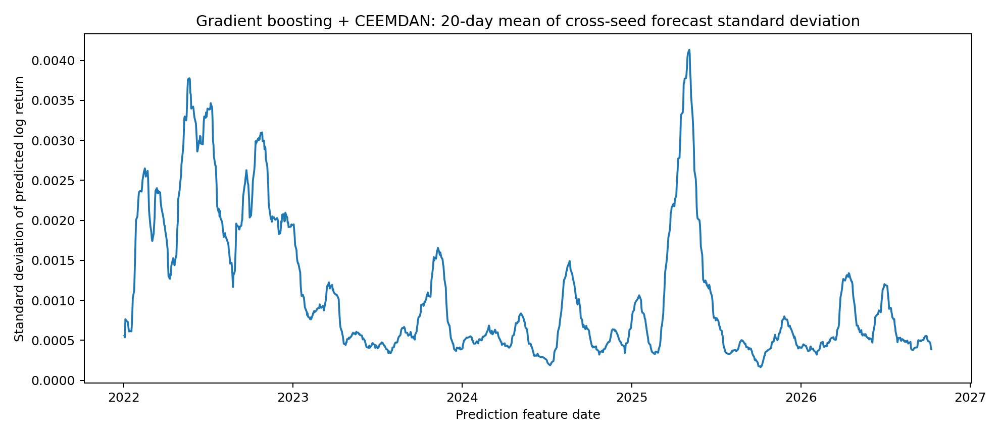

# CEEMDAN seed-stability audit

## Study design

Six CEEMDAN noise seeds (11, 22, 33, 42, 44, 55) evaluated on the same frozen SPY adjusted-price dataset using five expanding-window annual walk-forward test folds (2022–2026, with 2026 partial). Each run has 1,197 aligned predictions. The trials and feature specifications are the same across the runs. The original run inherited a code-default seed of 42; its older metadata does not explicitly list the seed.

## Reproducibility checks

- All six runs have identical dataset SHA-256 fingerprints, annual fold definitions, test dates, observed returns, and baseline forecasts (exact CSV equality).
- Repeating seed 11 produced an **exactly identical predictions CSV** for all five models in this local software environment.
- Distinct seeds changed both CEEMDAN-augmented models’ predictions while leaving baseline predictions unchanged.

## Aggregate metrics by seed

| Seed | Ridge + CEEMDAN RMSE | Boosting + CEEMDAN RMSE | Ridge + CEEMDAN direction acc. | Boosting + CEEMDAN direction acc. |
|---:|---:|---:|---:|---:|
| 11 | 0.010918394 | 0.011299494 | 50.46% | 51.13% |
| 22 | 0.010918529 | 0.011209438 | 50.54% | 53.38% |
| 33 | 0.010921173 | 0.011079053 | 50.88% | 51.55% |
| 42 | 0.010920281 | 0.011245853 | 49.46% | 53.05% |
| 44 | 0.010916397 | 0.011271052 | 50.38% | 51.46% |
| 55 | 0.010920899 | 0.011197704 | 50.63% | 52.72% |

## Descriptive statistics across six seeds

| Model | Mean RMSE | Sample SD | Min RMSE | Max RMSE |
|---|---:|---:|---:|---:|
| Ridge + CEEMDAN | 0.010919279 | 0.000001837 | 0.010916397 | 0.010921173 |
| Boosting + CEEMDAN | 0.011217099 | 0.000077483 | 0.011079053 | 0.011299494 |

Constant baseline RMSE: historical mean **0.010869395**, Ridge **0.010919431**, gradient boosting **0.011123549**.

## Figures

## Interpretation

Ridge + CEEMDAN exhibits small seed-to-seed RMSE variation. Gradient boosting + CEEMDAN exhibits greater variation; one seed outperformed the unaugmented gradient boosting baseline by RMSE, while the others did not. No CEEMDAN seed beat the historical-mean RMSE. **Do not select the best seed based on test-set results.**

## Limitations

- Six hand-selected seeds are a small exploratory set, not a random sample establishing uncertainty over all possible noise realizations. Standard deviations describe this particular set only.
- Repeating only seed 11 documents repeatability in the tested environment, not bitwise reproducibility across all hardware, libraries, or versions.
- The seed-42 value is inferred from the original code default, not directly recorded in the original metadata.
- No seed-aware statistical confidence intervals, repeated nested hyperparameter tuning, trading backtest, or financial-profitability claims.
- Future work: pin environments, log every seed explicitly, verify holdout target boundaries, and test seed stability on additional assets/periods.

Source: saved `run_metadata.json`, `predictions.csv`, and `overall_metrics.csv` from seven supplied experiment directories. Summary tables are recalculated from prediction CSVs.
